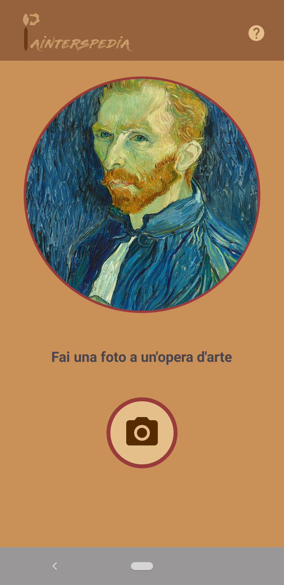
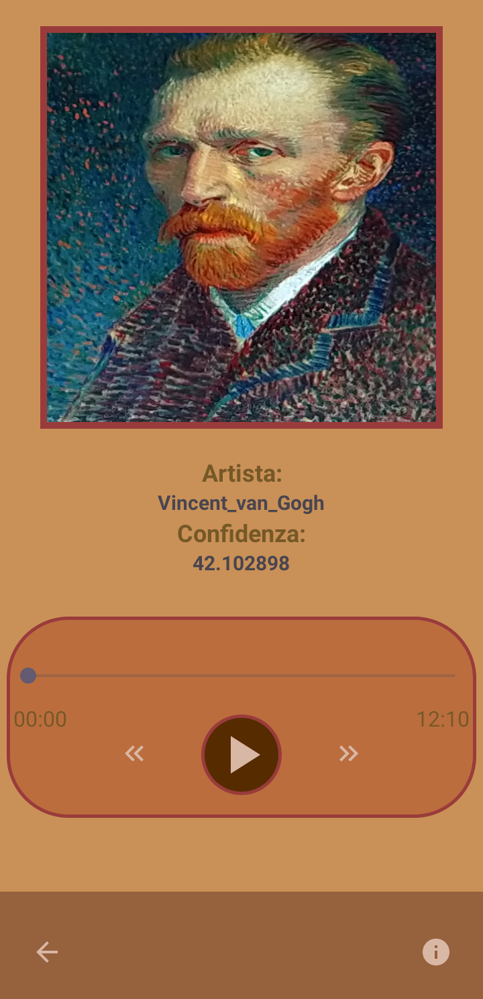
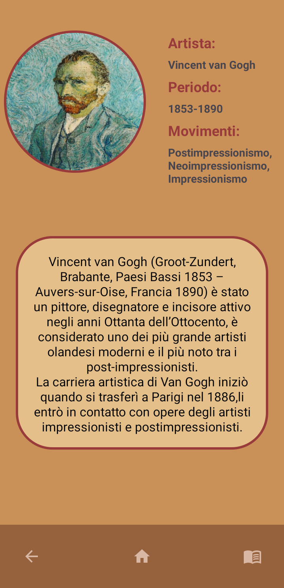
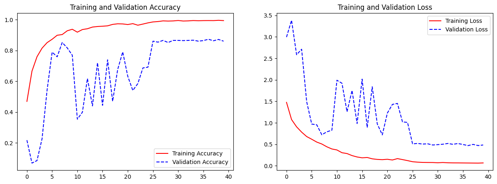
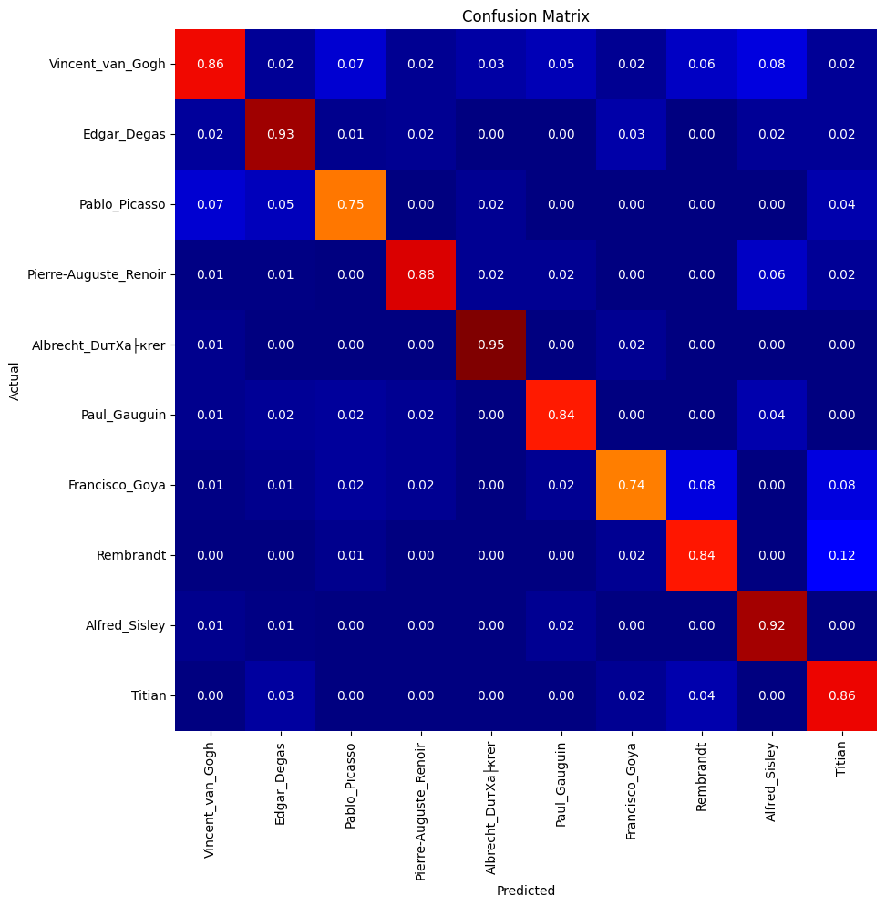

# Painterspedia



Prototype Android application for painting classification based on the artist,
developed as a Bachelor's thesis project.

## About

Painterspedia uses a ResNet50 deep learning model fine-tuned for
artist identification and converted to TensorFlow Lite to classify
paintings among 10 famous artists directly on the Android device,
without any internet connection required for inference.
The project covers the whole pipeline: training the model in Python (Keras/TensorFlow) and building the Android app from scratch in Java.

## How It Works

**Step 1 - Take a photo**

Open the app and take a photo of a painting with your device camera.

**Step 2 - Get the result**



The app identifies the artist and shows the confidence score.
An audio guide starts automatically for the identified artist.

**Step 3 - Explore the artist**



Tap the info button to read the full biography, artistic movement
details and open the Wikipedia page of the identified artist.

## Supported Artists

| Artist | Period | Movement |
|--------|--------|----------|
| Vincent Van Gogh | 1853-1890 | Post-Impressionism |
| Edgar Degas | 1834-1917 | Impressionism |
| Pablo Picasso | 1881-1973 | Cubism |
| Pierre-Auguste Renoir | 1841-1919 | Impressionism |
| Albrecht Durer | 1471-1528 | Northern Renaissance |
| Paul Gauguin | 1848-1903 | Post-Impressionism |
| Francisco Goya | 1746-1828 | Romanticism |
| Rembrandt | 1606-1669 | Baroque |
| Alfred Sisley | 1839-1899 | Impressionism |
| Titian | 1488-1576 | Renaissance |

## Features

- Take a photo of a painting with the device camera
- On-device classification using ResNet50 converted to TensorFlow Lite
- Confidence score displayed for the predicted artist
- Audio guide for each of the 10 identified artists
- Biographical information and artistic movement details for each artist
- Direct link to the artist's Wikipedia page

## Model Performance

The model was trained on the Best Artworks of All Time dataset
(Kaggle), selecting artists with more than 250 paintings available.
Training used a two-phase fine-tuning strategy on ResNet50
pretrained on ImageNet, with class weights to handle class imbalance,
data augmentation (horizontal and vertical flip, shear) and
Adam optimizer with learning rate 0.0001.

| Metric | Training set | Validation set |
|--------|-------------|----------------|
| Accuracy | 99.75% | 86.51% - 87.00% |
| Loss | 0.068 | 0.488 - 0.489 |



Per-class results on the validation set (800 images):

| Artist | Precision | Recall | F1-score | Support |
|--------|-----------|--------|----------|---------|
| Vincent Van Gogh | 0.86 | 0.86 | 0.86 | 172 |
| Edgar Degas | 0.86 | 0.93 | 0.89 | 138 |
| Pablo Picasso | 0.84 | 0.75 | 0.79 | 87 |
| Pierre-Auguste Renoir | 0.93 | 0.88 | 0.90 | 65 |
| Albrecht Durer | 0.94 | 0.95 | 0.95 | 65 |
| Paul Gauguin | 0.90 | 0.84 | 0.87 | 62 |
| Francisco Goya | 0.88 | 0.74 | 0.80 | 58 |
| Rembrandt | 0.83 | 0.84 | 0.83 | 51 |
| Alfred Sisley | 0.82 | 0.92 | 0.87 | 51 |
| Titian | 0.75 | 0.86 | 0.80 | 51 |
| **Weighted avg** | **0.86** | **0.86** | **0.86** | **800** |



The gap between training (99.75%) and validation (~87%) accuracy shows some overfitting, expected with about 4,000 images; results remain good across all 10 artists (F1 from 0.79 to 0.95).

## Technical Stack

- **Platform**: Android, min SDK 30 (Android 11), target SDK 33
- **Language**: Java
- **ML Model**: ResNet50 pretrained on ImageNet, fine-tuned on
  Best Artworks of All Time dataset, converted to TensorFlow Lite
- **Training environment**: Google Colab (Python, Keras, TensorFlow)
- **ML Binding**: TensorFlow Lite Support 0.1.0 with mlModelBinding
- **Input size**: 224x224 px, normalized to [0, 1]
- **Inference**: on-device, no internet required
- **UI**: ConstraintLayout, ViewBinding
- **Image loading**: Glide 4.15.1

## Model Architecture

Base model: ResNet50 pretrained on ImageNet with all layers
set to trainable.

Custom head added on top:
- Flatten
- Dense(16, he_uniform initialization)
- BatchNormalization
- ReLU activation
- Dense(10, softmax activation)

Training was performed in two phases. In the first phase all
layers were trained for 10 epochs. In the second phase all layers
were frozen except the first 50 layers of the model (the input and
the early ResNet50 blocks), which continued training for up to
30 epochs with early stopping on validation loss (patience 20) and
learning-rate reduction on plateau (factor 0.1, patience 5).

Other pretrained architectures were also tested, including Inception
and MobileNet. MobileNet was lighter but less accurate; ResNet50 gave
the best accuracy while still fitting the app's limits.

## App Architecture

The app is structured in three activities. MainActivity handles
camera input and photo capture via FileProvider. ArtistClassify
receives the image path, handles EXIF rotation correction,
runs the TFLite model inference and sets up the audio player
for the identified artist. ArtistInformation displays the
full biographical details, portrait and Wikipedia link
for the identified artist.

## Permissions

The app requires camera access for photo capture and storage
permissions for saving the temporary image file. On Android 11
and above it uses MANAGE_EXTERNAL_STORAGE.

## Installation

```bash
git clone https://github.com/LorenzoLattanzi-Git/Painterspedia.git
```

1. Open the project in Android Studio
2. Sync Gradle
3. Download the large files from the Downloads section
4. Run the app on a device or emulator with Android 11 or higher

## Requirements

- Android 11 (API 30) or higher
- Android Studio (for building from source)
- Gradle with multiDex enabled

## Dependencies

| Library | Version |
|---------|---------|
| androidx.appcompat | 1.6.1 |
| material | 1.5.0 |
| constraintlayout | 2.1.4 |
| tensorflow-lite-support | 0.1.0 |
| tensorflow-lite-gpu | 2.3.0 |
| glide | 4.15.1 |
| multidex | 1.0.0 |

## Dataset

Best Artworks of All Time - Kaggle.
Artists selected: those with 250 or more paintings available,
resulting in 10 classes.

| Split | Images |
|-------|--------|
| Training (80%) | 3252 |
| Validation (20%) | 808 |
| Total | 4060 |

Batch size: 16


## Downloads

Some files exceed GitHub's 100 MB repository limit, so they are attached to the [v1.0 release](https://github.com/LorenzoLattanzi-Git/Painterspedia/releases/tag/v1.0):

- [app-debug.apk](https://github.com/LorenzoLattanzi-Git/Painterspedia/releases/download/v1.0/app-debug.apk) → install it on an Android 11+ device to try the app, or place it in:  
  `ApplicazioneAndroid/Painterspedia/provaclasslite/app/build/intermediates/apk/debug/`

- [model_resnet50_deep_artist_identification.h5](https://github.com/LorenzoLattanzi-Git/Painterspedia/releases/download/v1.0/model_resnet50_deep_artist_identification.h5) → place in:  
  `Code/Modello/modelliresnet50/`


## Credits

The model training notebook was adapted from "Painter Identification using Deep Learning" on Kaggle (https://www.kaggle.com/code/kousikgvs/painter-identification-from-deep-learning). I compared several architectures, changed the artist selection and the data augmentation, and built the TFLite conversion and the Android app from scratch. Dataset: Best Artworks of All Time (Kaggle, CC BY-NC-SA 4.0).
